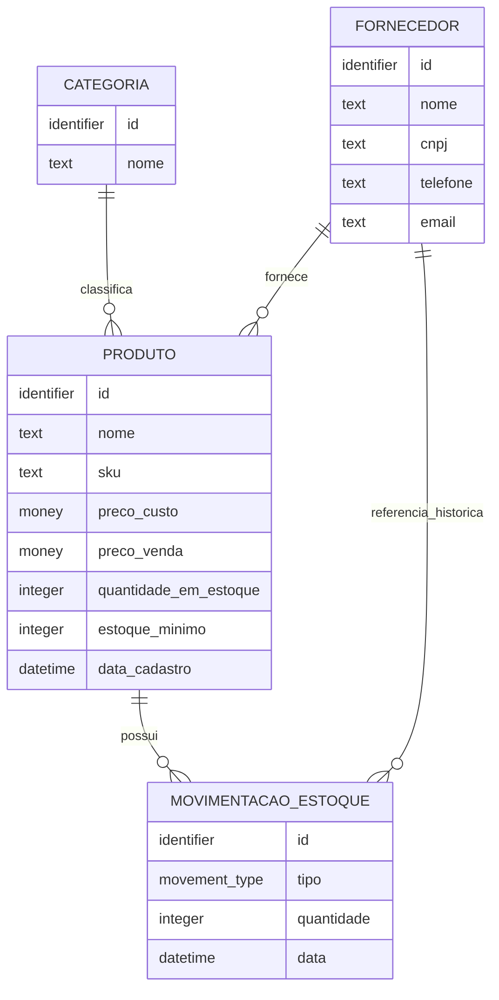

# StockFlow API — Domain and Data Modeling

## 1. Objetivo do documento

Este documento é o caderno vivo de modelagem de domínio e de dados do StockFlow API.

Ele acompanha toda a evolução da modelagem desde a análise inicial dos requisitos até o modelo físico implementado no PostgreSQL, passando pelo MER, DER e mapeamento E-R → relacional.

### Relação com outros documentos

**DECISIONS.md** é a fonte oficial do histórico de decisões técnicas e arquiteturais do projeto. Cada decisão importante deve estar registrada lá, com contexto, alternativas consideradas, escolha adotada, justificativa e consequências.

**DOMAIN_MODELING.md** (este documento) consolida o estado atual da modelagem e serve como referência técnica detalhada e consulta durante o desenvolvimento e a avaliação do projeto. Ele reflete as decisões já aprovadas em DECISIONS.md, mas não as antecipa.

---

### Estado atual da modelagem

| Área | Estado |
|---|---|
| DOM-001 a DOM-013 | RESOLVIDOS |
| MER (Domínio de Estoque) | APROVADO |
| DER Mermaid | CONSOLIDADO |
| Modelo Relacional | CONSOLIDADO |
| Modelo Físico PostgreSQL | IMPLEMENTADO E VALIDADO |
| Implementação SQLAlchemy/Alembic | MATERIALIZADO |
| Migrations | APLICADAS (01: schema inicial; 02: tabela usuarios) |
| Entidade de Apoio: Usuario | MATERIALIZADA (Fase 7 — DEC-034) |
| PostgreSQL de desenvolvimento | Operacional e validado |
| Estratégia de concorrência | IMPLEMENTADA E VALIDADA (with_for_update / tests/test_concorrencia.py) |

## 2. Convenções utilizadas

### MER — Modelo Entidade-Relacionamento

O MER é um modelo **conceitual**. Ele descreve o domínio do problema em termos de:

- **Entidades:** objetos ou conceitos relevantes do domínio (ex.: Produto, Fornecedor).
- **Atributos:** propriedades de cada entidade (ex.: nome, sku).
- **Relacionamentos:** associações entre entidades (ex.: Produto pertence a uma Categoria).
- **Cardinalidades:** quantidades envolvidas em cada relacionamento (1:1, 1:N, N:N).
- **Regras relevantes:** restrições e comportamentos do domínio.

O MER não fala de tabelas, colunas nem tipos de dados. É independente de tecnologia.

### DER — Diagrama Entidade-Relacionamento

O DER é a **representação visual** do MER. Neste projeto, o DER será expresso em sintaxe Mermaid (suportada pelo GitHub) para facilitar o versionamento e a revisão no repositório.

### Modelo Relacional

O modelo relacional é a **transformação** do MER em estruturas concretas de banco de dados relacional:

- relações (tabelas);
- chaves primárias (PK);
- chaves estrangeiras (FK);
- constraints de unicidade (UNIQUE);
- constraints de obrigatoriedade (NOT NULL);
- tabelas de associação quando necessárias (para relacionamentos N:N).

O modelo relacional ainda é independente do SGBD. Define a estrutura lógica, não os tipos físicos.

### Modelo Físico

O modelo físico é a **implementação concreta** no PostgreSQL. Inclui:

- tipos de dados específicos (INTEGER, VARCHAR, NUMERIC, TIMESTAMPTZ);
- constraints físicas (CHECK, DEFAULT, PRIMARY KEY, UNIQUE, FOREIGN KEY);
- índices;
- regras de exclusão (ON DELETE);
- nomes físicos de tabelas e colunas.

No projeto, o modelo físico é materializado como models SQLAlchemy e migrations Alembic.

### Sequência adotada no projeto

```
Requisitos do desafio
       ↓
Análise de domínio (TSK-2.1 / TSK-2.1B)
       ↓
Resolução de decisões DOM (TSK-2.2 / TSK-2.3)
       ↓
MER aprovado
       ↓
DER em Mermaid
       ↓
Mapeamento E-R → Modelo Relacional
       ↓
Modelo Físico PostgreSQL
       ↓
Models SQLAlchemy (TSK-2.7)
       ↓
Migrations Alembic (TSK-2.8)
```

Esta sequência garante que decisões de modelagem sejam explícitas e compreendidas antes de qualquer implementação.

---

## 3. Fonte dos requisitos

Os requisitos abaixo foram determinados diretamente pelo enunciado do desafio técnico. Nada foi acrescentado ou interpretado nesta seção.

### Produto

Campos mínimos obrigatórios:

- `id`
- `nome`
- `sku` / código único
- `preco_custo`
- `preco_venda`
- `quantidade_em_estoque`
- `data_cadastro`

### Fornecedor

Campos mínimos obrigatórios:

- `id`
- `nome`
- `cnpj` único
- `telefone`
- `email` único

### Categoria

Campos mínimos obrigatórios:

- `id`
- `nome` único

### Movimentação de Estoque

Campos mínimos obrigatórios:

- `id`
- `tipo` (entrada ou saída)
- `quantidade`
- `data`

### Regras de negócio explicitamente declaradas

- Movimentações são registros de auditoria.
- Movimentações são imutáveis: após criadas, não podem ser editadas nem excluídas pela API.
- Somente criação e consulta são permitidas para movimentações.
- Registrar uma movimentação deve refletir automaticamente na quantidade disponível em estoque.
- A modelagem deve garantir integridade referencial.
- O comportamento ao excluir uma categoria que ainda possui produtos deve ser definido.
- Deve existir consulta para produtos no estoque mínimo ou abaixo dele.
- Deve existir filtragem de movimentações por período.
- Deve existir filtragem de movimentações por fornecedor.

---

## 4. Entidades analisadas

### 4.1 Produto

**Responsabilidade no domínio:**
Produto é a entidade central do sistema. Representa um item físico gerenciado pelo estoque. Possui valor monetário, quantidade rastreada em tempo real e identificação única por SKU.

**Atributos explicitamente exigidos:**

| Atributo | Constraint explícita |
|---|---|
| `id` | Identificador único |
| `nome` | — |
| `sku` | UNIQUE |
| `preco_custo` | — |
| `preco_venda` | — |
| `quantidade_em_estoque` | Saldo inicial zero; alterado exclusivamente via Movimentação (DEC-012, DEC-013) |
| `data_cadastro` | — |

**Atributos adicionais aprovados:**

| Atributo | Constraint / Regra |
|---|---|
| `estoque_minimo` | Obrigatório, numérico inteiro, aceita zero, não aceita negativo (DEC-011) |

**Relacionamentos (todos resolvidos):**

- Categoria 1:N Produto (DEC-008)
- Fornecedor 1:N Produto, FK em Produto (DEC-009)
- Produto 1:N Movimentação

**Regras de domínio aprovadas:**

- Produto não pode ser excluído se possuir movimentações (DEC-019)
- `quantidade_em_estoque` alterada exclusivamente via Movimentação (DEC-012, DEC-013)

---

### 4.2 Fornecedor

**Responsabilidade no domínio:**
Fornecedor representa a entidade externa que provê produtos para a loja. Deve ser identificável de forma única por CNPJ e email.

Relaciona-se diretamente com produtos e movimentações. `Produto.fornecedor_id` representa o fornecedor cadastral atual do produto. `MovimentacaoEstoque.fornecedor_id` preserva a referência ao fornecedor associado ao produto no momento da criação da movimentação (DEC-010). A alteração do fornecedor cadastral pela API não modifica essa referência nas movimentações anteriores.

**Atributos explicitamente exigidos:**

| Atributo | Constraint explícita |
|---|---|
| `id` | Identificador único |
| `nome` | — |
| `cnpj` | UNIQUE |
| `telefone` | — |
| `email` | UNIQUE |

**Relacionamentos:**

- Fornecedor 1:N Produto
- Fornecedor 1:N Movimentação como referência histórica direta (MOVIMENTACAO_ESTOQUE.fornecedor_id → FORNECEDOR.id, DEC-010)

**Possíveis necessidades adicionais:**

- Nenhum campo adicional é necessário para satisfazer os requisitos obrigatórios do desafio. Endereço, site e demais dados cadastrais são fora do escopo.

**Regras de domínio aprovadas:**

- Fornecedor não pode ser excluído se possuir Produtos ou Movimentações associadas (DEC-020)

---

### 4.3 Categoria

**Responsabilidade no domínio:**
Categoria é uma classificação aplicada a produtos. É intencionalmente simples. Sua principal regra de negócio derivada é o comportamento ao ser excluída quando ainda possui produtos associados.

**Atributos explicitamente exigidos:**

| Atributo | Constraint explícita |
|---|---|
| `id` | Identificador único |
| `nome` | UNIQUE |

**Relacionamentos:**

- Categoria 1:N Produto

**Possíveis necessidades adicionais:**

- Nenhum campo adicional é identificado como necessário pelos requisitos do desafio.

**Regra de domínio aprovada:**

- Categoria referenciada por Produto não pode ser excluída (RESTRICT, DEC-018)

---

### 4.4 Movimentação de Estoque

**Responsabilidade no domínio:**
Movimentação é o registro imutável de auditoria de cada alteração no estoque de um produto. Representa um evento que já ocorreu. Não pode ser corrigida; erros são compensados por novas movimentações.

**Atributos exigidos e aprovados:**

| Atributo | Constraint/Regra |
|---|---|
| `id` | Identificador único (PK) |
| `produto_id` | FK obrigatória para Produto (inferência estrutural, IE-01) |
| `fornecedor_id` | FK histórica obrigatória para Fornecedor, capturada do Produto na criação (DEC-010) |
| `tipo` | ENTRADA ou SAIDA, conjunto fechado (DEC-016) |
| `quantidade` | Inteiro > 0, somente magnitude (DEC-014) |
| `data` | Instante determinado pelo sistema (DEC-017, DEC-030) |

**Regras de domínio aprovadas:**

- Saída não pode ultrapassar saldo disponível (DEC-015)
- Movimentação é imutável após criação (RE-05, RE-06)
- Produto não pode ser excluído se possuir movimentações (DEC-019)
- Fornecedor não pode ser excluído se possuir movimentações (DEC-020)

---

### 4.5 Entidade de Apoio: Usuário (Adicionada na Fase 7 — Autenticação e RBAC)

**Contexto e delimitação de escopo:**
A entidade `Usuario` não integrava as quatro entidades de negócio originais do desafio técnico (Produto, Fornecedor, Categoria e Movimentação). Foi introduzida na Fase 7 (DEC-034 e migration `13056bc612e1`) para suportar os diferenciais de autenticação via JWT e controle de autorização por papéis (RBAC — `ADMIN` e `FUNCIONARIO`).

**Responsabilidade no sistema:**
Armazenar credenciais de acesso seguro e a respectiva atribuição de papel administrativo ou operacional para autorização nas rotas da API.

**Atributos físicos e regras:**

| Atributo | Constraint / Regra |
|---|---|
| `id` | Identificador único numérico (PK, autoincrementado via Sequence tradicional do PostgreSQL: `nextval('usuarios_id_seq')`) |
| `username` | Identificador único de login (`VARCHAR(50)`, UNIQUE, NOT NULL) |
| `password_hash` | Hash da senha gerado via Argon2 (`VARCHAR(255)`, NOT NULL) |
| `role` | Papel de acesso (`VARCHAR(20)`, NOT NULL, `CHECK (role IN ('ADMIN', 'FUNCIONARIO'))`) |

**Estratégia de geração do identificador:**
Diferente das quatro entidades do domínio de estoque — cujos identificadores foram gerados com a sintaxe moderna `INTEGER GENERATED BY DEFAULT AS IDENTITY` (DEC-021 na migração `9a91e5d24c23`) —, a tabela `usuarios` foi mapeada com `mapped_column(Integer, primary_key=True)` (migração `13056bc612e1`), sem a cláusula explícita `Identity()`. Consequentemente, o PostgreSQL utiliza a estratégia de autoincremento padrão por Sequence associada (`usuarios_id_seq` via `DEFAULT nextval('usuarios_id_seq'::regclass)`). Ambas as abordagens garantem unicidade e integridade como chaves primárias.

**Relacionamentos com o domínio de estoque:**
- A entidade `Usuario` **não possui chave estrangeira** com Produto, Fornecedor, Categoria ou Movimentação de Estoque.
- As movimentações de estoque continuam com seu contrato centrado nas grandezas físicas do inventário (produto, quantidade, tipo, fornecedor histórico e data), mantendo o domínio de estoque desacoplado da camada de controle de acesso.

---

## 5. Requisitos, inferências e decisões

### 5.1 Requisitos explícitos

Fatos determinados diretamente pelo enunciado do desafio. Não exigem interpretação ou escolha.

| # | Requisito |
|---|---|
| RE-01 | Produto possui: id, nome, sku único, preco_custo, preco_venda, quantidade_em_estoque, data_cadastro |
| RE-02 | Fornecedor possui: id, nome, cnpj único, telefone, email único |
| RE-03 | Categoria possui: id, nome único |
| RE-04 | Movimentação possui: id, tipo (entrada/saída), quantidade, data |
| RE-05 | Movimentações são imutáveis após criação |
| RE-06 | API não oferece edição nem exclusão de movimentações |
| RE-07 | Criar movimentação deve atualizar automaticamente o estoque do produto |
| RE-08 | Integridade referencial deve ser garantida pelo modelo |
| RE-09 | Exclusão de categoria com produtos deve ter comportamento definido |
| RE-10 | Deve existir consulta de produtos no estoque mínimo ou abaixo dele |
| RE-11 | Movimentações devem ser filtráveis por período |
| RE-12 | Movimentações devem ser filtráveis por fornecedor |

---

### 5.2 Inferências estruturais necessárias

Estas conclusões não foram declaradas explicitamente no enunciado, mas são **necessárias** para que os requisitos explícitos possam ser implementados. Sem elas, um ou mais requisitos tornam-se tecnicamente irrealizáveis.

| # | Inferência | Requisito que a exige | Justificativa |
|---|---|---|---|
| IE-01 | Movimentação deve identificar o Produto afetado (`produto_id`) | RE-07 — movimentação atualiza o estoque | Sem saber qual produto alterar, a atualização de estoque é impossível |
| IE-02 | Produto precisa de um valor de referência de estoque mínimo | RE-10 — consulta de produtos no/abaixo do mínimo | Comparação `quantidade <= mínimo` é impossível sem o valor mínimo por produto |
| IE-03 | Criação de movimentação e atualização de estoque devem ser atômicas | RE-07; AGENTS.md — sem estado parcial | Falha entre os dois passos deixaria o banco em estado inconsistente |
| IE-04 | A API não deve alterar movimentações nem excluí-las | RE-05, RE-06 | Imutabilidade é requisito explícito; ausência de endpoints PUT/PATCH/DELETE para movimentações é necessária |

**Sobre IE-02 (estoque mínimo):**

A necessidade de um valor de referência foi confirmada estruturalmente. A solução aprovada é a criação do campo `estoque_minimo` diretamente na entidade Produto (ver DEC-011 e RA-04).

---

### 5.3 Histórico das regras propostas

*Todas as regras inicialmente propostas durante a análise de domínio foram formalmente resolvidas e promovidas a regras aprovadas (RAs). Não há regras propostas abertas.*

---

### 5.4 Decisões de modelagem aprovadas

As regras abaixo foram formalmente decididas e aprovadas:

| # | Regra aprovada | DEC correspondente |
|---|---|---|
| RA-01 | Um produto pertence a uma única categoria (cardinalidade 1:N) | DEC-008 |
| RA-02 | Um produto possui um único fornecedor cadastral (cardinalidade 1:N) | DEC-009 |
| RA-03 | Movimentação armazena referência direta e histórica ao fornecedor associado ao Produto no momento da criação | DEC-010 |
| RA-04 | Produto possui o atributo `estoque_minimo` (obrigatório, numérico inteiro, sem default, >= 0) | DEC-011 |
| RA-05 | `quantidade_em_estoque` é um saldo persistido, atualizado exclusivamente por Movimentação, não alterável livremente no CRUD | DEC-012 |
| RA-06 | Produto nasce com estoque zero; adição de estoque inicial exige Movimentação de entrada separada | DEC-013 |
| RA-07 | Quantidade da Movimentação deve ser estritamente maior que zero (representa apenas magnitude) | DEC-014 |
| RA-08 | Saída acima do saldo disponível no Produto é inválida; estoque negativo não é permitido | DEC-015 |
| RA-09 | O `tipo` de Movimentação é um conjunto fechado de 2 valores (ENTRADA e SAÍDA) | DEC-016 |
| RA-10 | A `data` da Movimentação é gerada pelo servidor no momento da criação | DEC-017 |
| RA-11 | Categoria não pode ser excluída se possuir produtos associados (RESTRICT) | DEC-018 |
| RA-12 | Produto não pode ser excluído se possuir movimentações (RESTRICT) | DEC-019 |
| RA-13 | Fornecedor não pode ser excluído se possuir produtos ou movimentações (RESTRICT) | DEC-020 |

---

## 6. Matriz de ambiguidades DOM

A matriz abaixo preserva as ambiguidades identificadas durante a análise de domínio e registra sua resolução. Todas as questões DOM-001 a DOM-013 estão atualmente **CLOSED / ACCEPTED**.

| ID | Questão | Requisito relacionado | Alternativas | Impacto | Dependências | Status |
|---|---|---|---|---|---|---|
| DOM-001 | Cardinalidade Categoria–Produto: um produto pertence a uma ou múltiplas categorias? | RE-09 (exclusão de categoria com produtos) | 1:N — FK em Produto; N:N — tabela associativa | Estrutura do banco; política de exclusão; complexidade do CRUD | — | **CLOSED / ACCEPTED (DEC-008)** |
| DOM-002 | Cardinalidade Fornecedor–Produto: um produto tem um ou múltiplos fornecedores? | RE-12 (filtro por fornecedor) | 1:N — FK em Produto; N:N — tabela associativa | Estrutura do banco; rastreabilidade histórica; complexidade do filtro | — | **CLOSED / ACCEPTED (DEC-009)** |
| DOM-003 | Como a Movimentação referencia o Fornecedor para permitir filtro? | RE-12 (filtro de movimentações por fornecedor) | (a) Join via Produto; (b) `supplier_id` opcional direto na movimentação | Rastreabilidade histórica se fornecedor do produto mudar; complexidade de JOIN | DOM-002 | **CLOSED / ACCEPTED (DEC-010)** |
| DOM-004 | Como representar estoque mínimo por produto? Nome, tipo, valor padrão, validações | RE-10 (consulta estoque mínimo) | Campo `estoque_minimo` em Produto; global fixo; parâmetro na query | Impossibilidade da consulta sem valor de referência | — | **CLOSED / ACCEPTED (DEC-011)** |
| DOM-005 | `quantidade_em_estoque` pode ser alterada diretamente no CRUD de Produto após criação? | RE-07 (movimentação atualiza estoque); auditoria | (A) Livre no CRUD; (B) Somente via movimentações; (C) Ajuste de inventário como tipo especial | Integridade e rastreabilidade do histórico | — | **CLOSED / ACCEPTED (DEC-012)** |
| DOM-006 | Como representar o estoque inicial de um produto recém-cadastrado? | RE-01 (campo `quantidade_em_estoque`) | (1) Campo direto na criação sem movimentação; (2) Sempre zero + movimentação manual; (3) Campo gera movimentação automática | Auditoria; UX da API; consistência | DOM-005 | **CLOSED / ACCEPTED (DEC-013)** |
| DOM-007 | O que acontece ao excluir um Produto que possui movimentações? | RE-05/RE-06 (imutabilidade); auditoria | RESTRICT; CASCADE (destrói histórico); SET NULL; soft delete | Preservação do histórico de auditoria | — | **CLOSED / ACCEPTED (DEC-019)** |
| DOM-008 | O que acontece ao excluir um Fornecedor relacionado a produtos ou movimentações? | RE-12 (filtro por fornecedor); integridade | RESTRICT; SET NULL; soft delete | Rastreabilidade histórica; integridade do filtro por fornecedor | DOM-003 | **CLOSED / ACCEPTED (DEC-020)** |
| DOM-009 | Como representar o tipo entrada/saída na Movimentação? | RE-04 (campo `tipo`) | Enum de banco; VARCHAR com CHECK; booleano | Clareza semântica; portabilidade entre SGBDs | — | **CLOSED / ACCEPTED (DEC-016)** |
| DOM-010 | A `data` da movimentação é gerada pelo servidor ou informada pelo cliente? | RE-04 (campo `data`) | Servidor (timestamp do momento da criação); cliente (informado no corpo da requisição) | Confiabilidade da auditoria; possibilidade de registros retroativos | — | **CLOSED / ACCEPTED (DEC-017)** |
| DOM-011 | Quantidade de movimentação aceita zero? Aceita negativo? | RE-07 (movimentação altera estoque) | Somente > 0; aceitar zero; aceitar negativo | Integridade dos registros de auditoria; significado semântico | — | **CLOSED / ACCEPTED (DEC-014)** |
| DOM-012 | Saída de estoque pode ultrapassar a quantidade disponível? | RE-07; integridade do estoque | Bloquear com erro; permitir (estoque negativo); permitir com alerta | Possibilidade de estoque negativo | DOM-011 | **CLOSED / ACCEPTED (DEC-015)** |
| DOM-013 | O que acontece ao excluir uma Categoria que possui produtos associados? | RE-09 (comportamento explicitamente mencionado) | RESTRICT; SET NULL (produto sem categoria); CASCADE (deleta produtos); soft delete da categoria | Integridade dos produtos; produtos órfãos de categoria | DOM-001 | **CLOSED / ACCEPTED (DEC-018)** |

---

## 7. Ordem histórica de resolução das decisões DOM

A ordem abaixo foi utilizada para resolver as ambiguidades respeitando as dependências entre decisões. Está registrada como histórico, não como fila de trabalho atual.

| Prioridade | ID | Justificativa da posição |
|---|---|---|
| **Resolvido** | **DOM-001** | **Define se haverá FK simples ou tabela associativa entre Produto e Categoria** |
| **Resolvido** | **DOM-002** | **Define se haverá FK simples ou tabela associativa entre Produto e Fornecedor** |
| **Resolvido** | **DOM-003** | **Depende de DOM-002; define o modelo de rastreabilidade do fornecedor na movimentação** |
| **Resolvido** | **DOM-004** | **Define campo adicional em Produto; necessário para a consulta de estoque mínimo** |
| **Resolvido** | **DOM-005** | **Define regra central de negócio para o CRUD de Produto** |
| **Resolvido** | **DOM-006** | **Depende de DOM-005; define o comportamento da criação do produto com estoque** |
| **Resolvido** | **DOM-009** | **Define o campo `tipo` no modelo de movimentação** |
| **Resolvido** | **DOM-010** | **Define o campo `data` no modelo de movimentação** |
| **Resolvido** | **DOM-011** | **Define validação de quantidade na movimentação** |
| **Resolvido** | **DOM-012** | **Define regra de negócio para saídas; depende de DOM-011** |
| **Resolvido** | **DOM-013** | **Define comportamento de exclusão de Categoria; depende de DOM-001** |
| **Resolvido** | **DOM-007** | **Define comportamento de exclusão de Produto; depende do CRUD estar estruturado** |
| **Resolvido** | **DOM-008** | **Define comportamento de exclusão de Fornecedor; depende de DOM-003** |

> A ordem pode ser ajustada se novas dependências forem identificadas durante a implementação. Qualquer ajuste deve ser justificado.

---

## 8. MER — Modelo Conceitual

**Status: APROVADO NO NÍVEL CONCEITUAL**

O MER deve representar somente o domínio aprovado.

### Entidades e Atributos

**CATEGORIA**
- id
- nome

**FORNECEDOR**
- id
- nome
- cnpj
- telefone
- email

**PRODUTO**
- id
- nome
- sku
- preco_custo
- preco_venda
- quantidade_em_estoque
- estoque_minimo
- data_cadastro

**MOVIMENTACAO_ESTOQUE**
- id
- tipo
- quantidade
- data

### Relacionamentos identificados

| Relacionamento | Lado A | Lado B | Justificativa |
|---|---|---|---|
| Categoria ↔ Produto | CATEGORIA (0,N) | (1,1) PRODUTO | Categoria pode existir antes de possuir Produtos (min 0). Produto não existe no modelo aprovado sem Categoria (min 1, max 1). |
| Fornecedor ↔ Produto | FORNECEDOR (0,N) | (1,1) PRODUTO | Fornecedor pode existir antes de possuir Produtos (min 0). Produto não existe no modelo aprovado sem Fornecedor (min 1, max 1). |
| Produto ↔ Movimentação | PRODUTO (0,N) | (1,1) MOVIMENTACAO_ESTOQUE | Produto nasce sem necessidade de possuir Movimentação (min 0). Movimentação não existe sem Produto (min 1, max 1). |
| Fornecedor ↔ Movimentação | FORNECEDOR (0,N) | (1,1) MOVIMENTACAO_ESTOQUE | Fornecedor pode existir sem aparecer ainda no histórico (min 0). Movimentação não existe sem Fornecedor histórico (min 1, max 1). |

### Principais regras conceituais aprovadas

- Produto nasce com quantidade_em_estoque = 0;
- quantidade_em_estoque só é alterada por Movimentações;
- estoque_minimo é obrigatório;
- estoque_minimo aceita zero;
- estoque_minimo não aceita negativo;
- tipo possui somente ENTRADA ou SAÍDA;
- quantidade da Movimentação deve ser > 0;
- SAÍDA não pode superar o saldo disponível;
- data/hora da Movimentação é determinada pelo servidor;
- Movimentações são imutáveis;
- Produto com histórico não pode ser excluído;
- Categoria referenciada por Produtos não pode ser excluída;
- Fornecedor referenciado por Produto ou Movimentação não pode ser excluído.

---

## 9. DER — Diagrama Entidade-Relacionamento

**Status: CONSOLIDADO**

O DER será representado em sintaxe Mermaid (`erDiagram`) e versionado nesta seção.



**Legenda da notação Crow's Foot e cardinalidades (min, max):**
- `||` representa **exatamente um** `(1,1)`.
- `o{` representa **zero ou muitos** `(0,N)`.
- A cardinalidade `(1,N)` (um ou muitos) **não existe** nestes relacionamentos porque o sistema não exige que entidades de cadastro (Categoria, Fornecedor ou Produto) já nasçam com registros dependentes associados.
- Se Mermaid exige tipos antes dos atributos, usamos aqui nomes conceituais (como `identifier`, `text`, `money`, `datetime`, `movement_type`) para não misturar com o modelo físico.

---

## 10. Mapeamento E-R → Modelo Relacional

**Status: CONSOLIDADO**

### Ausência de tabelas associativas

Nenhum relacionamento aprovado é N:N. Por isso o modelo atual NÃO precisa de tabelas associativas para Categoria–Produto ou Fornecedor–Produto. A decisão de utilizar 1:N foi deliberada e documentada. Não se deve criar tabelas como `produto_categoria`, `produto_fornecedor` ou qualquer outra tabela associativa.

### Mapeamento dos relacionamentos (Migração de Chaves)

1. **CATEGORIA 1:N PRODUTO**
   A PK de Categoria é referenciada como FK no lado N: `PRODUTO.categoria_id → CATEGORIA.id`. Como Produto participa com (1,1), `categoria_id` será logicamente obrigatório.
2. **FORNECEDOR 1:N PRODUTO**
   A PK de Fornecedor é referenciada como FK no lado N: `PRODUTO.fornecedor_id → FORNECEDOR.id`. Esse campo representa o fornecedor cadastral atual do Produto.
3. **PRODUTO 1:N MOVIMENTACAO_ESTOQUE**
   A PK de Produto é referenciada como FK no lado N: `MOVIMENTACAO_ESTOQUE.produto_id → PRODUTO.id`. Toda Movimentação pertence a exatamente um Produto.
4. **FORNECEDOR 1:N MOVIMENTACAO_ESTOQUE**
   A PK de Fornecedor é referenciada como FK no lado N: `MOVIMENTACAO_ESTOQUE.fornecedor_id → FORNECEDOR.id`. Esse campo possui semântica histórica:
   - `Produto.fornecedor_id` = fornecedor cadastral atual;
   - `Movimentacao.fornecedor_id` = fornecedor associado ao Produto no momento da Movimentação.
   Não se deve eliminar nenhuma das duas FKs como "duplicação".

### Modelo Lógico Esperado

CATEGORIA
---------
id PK
nome UNIQUE NOT NULL

FORNECEDOR
----------
id PK
nome NOT NULL
cnpj UNIQUE NOT NULL
telefone NOT NULL
email UNIQUE NOT NULL

PRODUTO
-------
id PK
nome NOT NULL
sku UNIQUE NOT NULL
preco_custo NOT NULL
preco_venda NOT NULL
quantidade_em_estoque NOT NULL
estoque_minimo NOT NULL
data_cadastro NOT NULL
categoria_id FK → CATEGORIA.id NOT NULL
fornecedor_id FK → FORNECEDOR.id NOT NULL

MOVIMENTACAO_ESTOQUE
--------------------
id PK
tipo NOT NULL
quantidade NOT NULL
data NOT NULL
produto_id FK → PRODUTO.id NOT NULL
fornecedor_id FK → FORNECEDOR.id NOT NULL

USUARIOS (Entidade de apoio / autenticação — Fase 7)
--------
id PK
username UNIQUE NOT NULL
password_hash NOT NULL
role CHECK (role IN ('ADMIN', 'FUNCIONARIO')) NOT NULL

### Regras Lógicas Adicionais do Modelo

- **CATEGORIA**: nome único.
- **FORNECEDOR**: cnpj único; email único.
- **PRODUTO**: sku único; `estoque_minimo >= 0`; `quantidade_em_estoque` inicia conceitualmente em zero; saldo não é alterado pelo CRUD comum.
- **MOVIMENTACAO_ESTOQUE**: `tipo ∈ {ENTRADA, SAÍDA}`; `quantidade > 0`; imutável após criação; SAÍDA não pode produzir estoque negativo.

*(Nota: As constraints lógicas acima não representam ainda comandos SQL diretos)*

### Matriz de Rastreabilidade

| Elemento do MER | Cardinalidade (min,max) | Implementação Relacional | Decisão relacionada | Motivo |
|---|---|---|---|---|
| Categoria ↔ Produto | (0,N) ↔ (1,1) | `PRODUTO.categoria_id` FK | DEC-008 | FK no lado N. |
| Fornecedor ↔ Produto | (0,N) ↔ (1,1) | `PRODUTO.fornecedor_id` FK | DEC-009 | FK no lado N. |
| Produto ↔ Movimentação | (0,N) ↔ (1,1) | `MOVIMENTACAO_ESTOQUE.produto_id` FK | Inferência estrutural / decisões de domínio | FK no lado N. |
| Fornecedor ↔ Movimentação | (0,N) ↔ (1,1) | `MOVIMENTACAO_ESTOQUE.fornecedor_id` FK | DEC-010 | Preservação histórica. |

---

## 11. Distinção entre os Níveis de Modelagem

- **MER:** visão conceitual do domínio.
- **DER:** representação visual do MER.
- **Modelo Relacional:** relações, atributos, PK, FK e constraints lógicas. Independente de SGBD.
- **Modelo Físico PostgreSQL:** IMPLEMENTADO E VALIDADO. Inclui tipos, constraints (CHECK, DEFAULT, ON DELETE), índices e política temporal materializados no banco.

**Implementado com Sucesso:**
- Models SQLAlchemy (TSK-2.7);
- Configuração do Alembic (TSK-2.8);
- Migrations;
- Schema real criado no PostgreSQL.

## 12. Modelo Físico PostgreSQL

**Status: IMPLEMENTADO E VALIDADO no PostgreSQL.**

A representação dos dados no SGBD PostgreSQL está definida abaixo. Todos os tipos, constraints (`CHECK`, `DEFAULT`, `ON DELETE`) e índices já foram aprovados documentalmente.

### Tipos Físicos e Colunas

| Tabela | Coluna | Tipo PostgreSQL | Origem/semântica | Observação |
|---|---|---|---|---|
| Categoria | id | `INTEGER GENERATED BY DEFAULT AS IDENTITY` | PK | PRIMARY KEY |
| Categoria | nome | `VARCHAR(100)` | Texto | NOT NULL, UNIQUE |
| Fornecedor | id | `INTEGER GENERATED BY DEFAULT AS IDENTITY` | PK | PRIMARY KEY |
| Fornecedor | nome | `VARCHAR(150)` | Texto | NOT NULL |
| Fornecedor | cnpj | `VARCHAR(14)` | Texto normalizado | NOT NULL, UNIQUE, `CHECK (char_length(cnpj) = 14 AND cnpj ~ '^[0-9]+$')` |
| Fornecedor | telefone | `VARCHAR(20)` | Texto | NOT NULL |
| Fornecedor | email | `VARCHAR(254)` | Texto | NOT NULL, UNIQUE |
| Produto | id | `INTEGER GENERATED BY DEFAULT AS IDENTITY` | PK | PRIMARY KEY |
| Produto | nome | `VARCHAR(150)` | Texto | NOT NULL |
| Produto | sku | `VARCHAR(50)` | Texto único | NOT NULL, UNIQUE |
| Produto | preco_custo | `NUMERIC(12,2)` | Valor monetário exato | NOT NULL, `CHECK (preco_custo >= 0)` |
| Produto | preco_venda | `NUMERIC(12,2)` | Valor monetário exato | NOT NULL, `CHECK (preco_venda >= 0)` |
| Produto | quantidade_em_estoque | `INTEGER` | Unidade inteira | NOT NULL, `DEFAULT 0`, `CHECK (quantidade_em_estoque >= 0)` |
| Produto | estoque_minimo | `INTEGER` | Unidade inteira | NOT NULL, `CHECK (estoque_minimo >= 0)` |
| Produto | data_cadastro | `TIMESTAMPTZ` | Instante temporal | NOT NULL, `DEFAULT CURRENT_TIMESTAMP` |
| Produto | categoria_id | `INTEGER` | FK para Categoria | NOT NULL, `ON DELETE RESTRICT` |
| Produto | fornecedor_id | `INTEGER` | FK para Fornecedor | NOT NULL, `ON DELETE RESTRICT` |
| Movimentacao_Estoque | id | `INTEGER GENERATED BY DEFAULT AS IDENTITY` | PK | PRIMARY KEY |
| Movimentacao_Estoque | tipo | `VARCHAR(7)` | 'ENTRADA' ou 'SAIDA' | NOT NULL, `CHECK (tipo IN ('ENTRADA', 'SAIDA'))` |
| Movimentacao_Estoque | quantidade | `INTEGER` | Magnitude | NOT NULL, `CHECK (quantidade > 0)` |
| Movimentacao_Estoque | data | `TIMESTAMPTZ` | Instante temporal | NOT NULL, `DEFAULT CURRENT_TIMESTAMP` |
| Movimentacao_Estoque | produto_id | `INTEGER` | FK para Produto | NOT NULL, `ON DELETE RESTRICT` |
| Movimentacao_Estoque | fornecedor_id | `INTEGER` | FK para Fornecedor | NOT NULL, `ON DELETE RESTRICT` |
| usuarios | id | `INTEGER` (Sequence: `nextval('usuarios_id_seq')`) | PK | PRIMARY KEY (autoincremento via Sequence/SERIAL) |
| usuarios | username | `VARCHAR(50)` | Identificador de acesso | NOT NULL, UNIQUE |
| usuarios | password_hash | `VARCHAR(255)` | Hash Argon2 | NOT NULL |
| usuarios | role | `VARCHAR(20)` | Perfil de permissão RBAC | NOT NULL, `CHECK (role IN ('ADMIN', 'FUNCIONARIO'))` |

### Regras físicas mantidas na Aplicação (Fora do DB Schema)

- **Validação de estoque disponível na saída:** O banco de dados assegura apenas que `quantidade_em_estoque >= 0` via `CHECK`. A regra de negócio que impede uma saída superior ao saldo disponível depende do estado dinâmico do Produto e é validada transacionalmente na aplicação com bloqueio pessimista (`SELECT ... FOR UPDATE`), retornando HTTP 409 Conflict em caso de saldo insuficiente.
- **Imutabilidade da Movimentação:** Garantida pelo contrato da API, que não expõe rotas de edição (`PUT`/`PATCH`) ou exclusão (`DELETE`) para a entidade `MovimentacaoEstoque`. Optou-se por não utilizar triggers no PostgreSQL para evitar regras procedurais ocultas no banco de dados.
- **Formato do CNPJ:** O banco de dados assegura apenas que o campo possua 14 caracteres numéricos (`CHECK (char_length(cnpj) = 14 AND cnpj ~ '^[0-9]+$')`), espelhado na API via expressão regular no Pydantic (`pattern=r'^\d{14}$'`). O cálculo algorítmico de dígitos verificadores não é realizado nesta versão, permanecendo fora do escopo obrigatório do desafio.
- **Bloqueio de estoque inicial:** No PostgreSQL, o campo possui `DEFAULT 0`. No nível da API, o schema de cadastro `ProdutoCreate` omite o campo e rejeita atributos adicionais (`extra="forbid"`), garantindo que todo produto seja criado com saldo zero e que incrementos ocorram unicamente via movimentações auditadas.


### Fundamentação de Performance e Estratégia de Índices

A escolha dos tipos físicos descritos acima influencia o armazenamento, o tamanho dos índices e a performance das comparações e JOINs. Contudo, **não determina sozinha** o desempenho das buscas. O desempenho real dependerá também do padrão de consultas, da seletividade, volume de dados e do plano de execução do banco (PostgreSQL).

Por exemplo:
- O uso sistemático de `INTEGER` para as chaves (PK/FK) favorece chaves e índices compactos, otimizando as buscas.
- Restrições `UNIQUE` (como no CNPJ, SKU) geram automaticamente a necessidade de uma estrutura eficiente para unicidade.
- O tipo `NUMERIC` foi escolhido para assegurar a exatidão monetária absoluta (prevenindo falhas de arredondamento de float), e não por ser o tipo aritmeticamente mais rápido.

### Índices e Padrões de Acesso

| Tabela | Coluna(s) | Origem | Consulta/uso | Justificativa |
|---|---|---|---|---|
| Categoria | id | PK | Identificador único | Índice automático no PostgreSQL. |
| Categoria | nome | UNIQUE | Restrição de unicidade | Índice automático no PostgreSQL. |
| Fornecedor | id | PK | Identificador único | Índice automático no PostgreSQL. |
| Fornecedor | cnpj | UNIQUE | Restrição de unicidade | Índice automático no PostgreSQL. |
| Fornecedor | email | UNIQUE | Restrição de unicidade | Índice automático no PostgreSQL. |
| Produto | id | PK | Identificador único | Índice automático no PostgreSQL. |
| Produto | sku | UNIQUE | Restrição de unicidade | Índice automático no PostgreSQL. |
| Produto | categoria_id | Adicional | JOINs e Listagens | Desempenho de JOINs e operações referenciais. A FK funciona sem índice. |
| Produto | fornecedor_id | Adicional | JOINs e Listagens | Desempenho de JOINs e operações referenciais. A FK funciona sem índice. |
| Movimentacao_Estoque | id | PK | Identificador único | Índice automático no PostgreSQL. |
| Movimentacao_Estoque | produto_id | Adicional | JOINs e Listagens | Desempenho de JOINs e operações referenciais. A FK funciona sem índice. |
| Movimentacao_Estoque | data | Adicional | Filtros de busca | Filtragem obrigatória por período isolado. |
| Movimentacao_Estoque | fornecedor_id, data | Adicional | Filtros de busca | Filtragem obrigatória apenas por fornecedor, ou fornecedor com período (aproveitando o prefixo à esquerda). |
| usuarios | id | PK | Identificador único | Índice automático no PostgreSQL. |
| usuarios | username | UNIQUE | Busca no login | Índice automático de unicidade no PostgreSQL. |

### Política de Timezone e TIMESTAMPTZ

O tipo físico `TIMESTAMPTZ` (usado em `Produto.data_cadastro` e `Movimentacao_Estoque.data`) representa um instante absoluto no tempo. O PostgreSQL não preserva em cada valor o nome do timezone original informado pelo cliente. Por exemplo, `2026-09-29 14:00:00-03:00` e `2026-09-29 17:00:00+00:00` representam exatamente o mesmo instante.

Como política operacional do StockFlow:
- **UTC** será a referência temporal operacional interna para evitar ambiguidades.
- Os campos que representam instantes permanecem `TIMESTAMPTZ`.
- O backend deverá trabalhar futuramente apenas com datetimes *timezone-aware* (cientes de fuso horário).
- Timestamps não devem ser tratados como datetimes ingênuos (*naive*).
- A data/hora da Movimentação continua sendo determinada pelo sistema (`DEFAULT CURRENT_TIMESTAMP`), o cliente não possui esse valor como campo livre de criação, e não há regras de retroatividade alteradas.
- Filtros temporais futuros deverão comparar instantes de maneira *timezone-aware*.
- A conversão para o timezone local do usuário pertence à camada de apresentação/contexto da API. Não armazenaremos o timezone local do usuário como um atributo separado nesta versão.

### Estratégia Transacional e de Concorrência

#### 1. Histórico da Fase de Modelagem (DEC-031)
Durante a fase inicial de modelagem de dados, definiu-se a estratégia conceitual para prevenir anomalias de concorrência (como o antipadrão *lost update* e saídas que pudessem produzir estoque negativo). A abordagem adotou o bloqueio pessimista focado na linha do Produto (`SELECT ... FOR UPDATE`), operando sob o nível de isolamento padrão `READ COMMITTED` do PostgreSQL.

**Fluxo transacional planejado:**
`BEGIN`
1. Localizar o Produto pelo id utilizando bloqueio pessimista `FOR UPDATE`.
2. Interromper a operação se o Produto não existir.
3. Ler o saldo atual (`quantidade_em_estoque`) e fornecedor atual (`fornecedor_id`) da linha bloqueada.
4. Validar a Movimentação. Para SAÍDA: verificar se `quantidade <= saldo_atual`. Se não houver saldo suficiente, interromper sem criar Movimentação e sem alterar o Produto.
5. Calcular o novo saldo.
6. Atualizar a `quantidade_em_estoque` na tabela Produto.
7. Criar a `MOVIMENTACAO_ESTOQUE` contendo os dados, incluindo o fornecedor histórico recém capturado da linha bloqueada.
`COMMIT` (Qualquer falha após o BEGIN resulta em `ROLLBACK`).

#### 2. Implementação e Validação no Código (Fase 7 — TSK-7.3)
A estratégia transacional descrita acima foi **efetivamente implementada e validada no código durante a Fase 7**:

- **Implementação:** No router `app/routers/movimentacoes.py` (função `criar_movimentacao`), a query utiliza `select(Produto).where(Produto.id == mov_in.produto_id).with_for_update()`.
- **Atomicidade e Integridade:** A alteração do saldo (`quantidade_em_estoque`) e a inserção da `MovimentacaoEstoque` ocorrem sob a mesma transação com `db.commit()` ou `db.rollback()` em blocos `except IntegrityError` e `except Exception`.
- **Validação Automatizada:** Em `tests/test_concorrencia.py` (`test_concorrencia_saida_simultanea`), a proteção contra corrida foi testada disparando requisições paralelas via threads com barreira de sincronização (`threading.Barrier`). Em um cenário com 10 unidades em estoque e duas tentativas simultâneas de saída de 8 unidades cada, exatamente uma requisição é aprovada (HTTP 201, restando saldo 2) e a segunda é rejeitada (HTTP 409 Conflict por estoque insuficiente), sem corrupção do saldo e mantendo rigorosamente a consistência do histórico de auditoria.

**Ressalvas técnicas sobre concorrência, contenção e deadlocks:**
- **Nível do bloqueio e contenção normal:** O comando `FOR UPDATE` bloqueia a linha do Produto em disputa (*row-level lock*), associado a bloqueios de tabela que o PostgreSQL adquire durante a execução do comando (como o modo `ROW SHARE`). Transações concorrentes que movimentam o mesmo produto competem pela mesma linha, gerando contenção normal: a segunda transação é colocada em espera por bloqueio (*lock wait*) até que a primeira conclua seu ciclo com `COMMIT` ou `ROLLBACK`.
- **Cenário validado em teste:** O teste automatizado em `tests/test_concorrencia.py` valida especificamente esse comportamento de contenção e espera sequencial sobre um único produto: a transação subsequente aguarda a liberação do lock, lê o saldo rebaixado de forma consistente e falha controladamente por regra de negócio (HTTP 409 Conflict), sem corrupção de estado.
- **Diferença entre espera por bloqueio e deadlock:** A retenção temporária em fila (*lock wait*) observada na criação de movimentações é um comportamento esperado de serialização e não deve ser confundida com *deadlock*. O deadlock é uma anomalia em que duas ou mais transações aguardam recursos mutuamente travados em ciclo de dependências (por exemplo, a Transação A bloqueia o Registro 1 e aguarda o Registro 2, enquanto a Transação B bloqueia o Registro 2 e aguarda o Registro 1). Diante desse cenário, o PostgreSQL detecta ativamente o ciclo e interrompe uma das transações envolvidas (*deadlock detected*), desfazendo-a para quebrar o bloqueio mútuo.
- **Limites da estratégia:** A operação de movimentação no StockFlow bloqueia pontualmente uma única linha de produto antes de inserir o registro histórico, reduzindo expressivamente o risco de deadlocks nessa rota. Contudo, isso não constitui uma garantia universal contra deadlocks em qualquer cenário futuro ou em fluxos transacionais mais complexos que venham a envolver múltiplos registros dependentes. Da mesma forma, o bloqueio pessimista não elimina riscos externos de infraestrutura, como a exaustão do pool de conexões do banco de dados sob altíssima concorrência simultânea.

---

## 13. Não requisitos — Controle de escopo

As funcionalidades abaixo estão **fora do escopo atual** do StockFlow API. Nenhuma delas deve ser introduzida sem instrução explícita do desenvolvedor.

### Fora do escopo

| Funcionalidade | Motivo |
|---|---|
| Múltiplos depósitos / localizações de estoque | Não mencionado no desafio |
| Controle por lote | Não mencionado no desafio |
| Data de validade | Não mencionada no desafio |
| Código de barras (EAN) | Não mencionado; SKU cobre identificação |
| Endereço do fornecedor | Não mencionado; campos exigidos são nome, CNPJ, telefone e email |
| Usuário responsável pela movimentação | Autenticação é diferencial, tratado separadamente |
| Pedidos de compra | Não mencionado; movimentação de entrada cobre a entrada de mercadoria |
| Vendas / pedidos de venda | Não mencionado; movimentação de saída cobre a saída |
| Clientes | Não mencionados no desafio |
| Notas fiscais | Não mencionadas no desafio |
| Reserva de estoque | Não mencionada; exigiria estado intermediário entre disponível e reservado |
| Fotos e imagens de produto | Não mencionadas no desafio |
| Preço por fornecedor | Não mencionado; tornaria a relação Produto–Fornecedor mais complexa sem requisito |

### Possíveis extensões futuras (não requisitos atuais)

| Funcionalidade | Observação |
|---|---|
| Observação / motivo na movimentação | Útil em prática (ex.: "entrada por reposição", "saída por avaria"), mas não exigido |
| Unidade de medida do produto | Relevante para produtos não unitários (kg, litros), mas não mencionado no desafio |

Estas extensões não devem ser tratadas como requisitos enquanto o enunciado não as exigir.

---

## 14. Fundamentação das decisões de modelagem e arquitetura

Esta seção reúne perguntas e respostas fundamentando as escolhas de modelagem de dados do StockFlow API frente aos critérios de engenharia de software e integridade relacional.

### Conceitos gerais

**O que é MER?**
O Modelo Entidade-Relacionamento é uma representação conceitual do domínio. Descreve as entidades, seus atributos, os relacionamentos entre elas e as cardinalidades, de forma independente de tecnologia.

**O que é DER?**
O Diagrama Entidade-Relacionamento é a representação visual gráfica do MER.

**Qual a diferença entre modelo relacional e físico?**
O modelo relacional define a estrutura lógica independente de SGBD (tabelas, PKs, FKs, constraints lógicas). O modelo físico é a implementação real (ex: PostgreSQL) com tipos nativos, sintaxe SQL específica e definições de armazenamento.

**Como o MER foi convertido para o modelo relacional?**
Transformando entidades em tabelas, atributos em colunas e aplicando regras de migração de chaves (a PK do lado 1 é referenciada como FK no lado N).

**O que significa cardinalidade mínima e máxima?**
A mínima define se o relacionamento é opcional (0) ou obrigatório (1). A máxima define o limite de associações: apenas uma (1) ou múltiplas (N).

**Por que a FK fica no lado N?**
Porque o modelo relacional exige valores atômicos por coluna (1ª Forma Normal). O lado N pode ter vários registros apontando para o mesmo pai (lado 1).

**Por que não existe tabela associativa?**
Porque o modelo aprovado não possui relacionamentos N:N. Relacionamentos 1:N são resolvidos diretamente com chave estrangeira (FK) na própria tabela dependente.

**Por que os tipos PostgreSQL só foram definidos depois do modelo relacional?**
Para manter a separação de responsabilidades entre os níveis de modelagem. Definir tipos físicos durante a modelagem lógica anteciparia restrições irrelevantes àquela etapa e acoplaria o modelo conceitual/lógico a decisões de implementação.

**Qual a diferença entre uma regra garantida pelo banco e uma regra garantida pela aplicação?**
Uma regra no banco (como `NOT NULL`, `CHECK`) atua como a última linha de defesa estrutural, impedindo dados inválidos em qualquer nível. A regra na aplicação (como bloquear saída sem saldo) é ideal para lógicas de negócio complexas, orquestração de transações ou dependências de estado dinâmico (onde o banco precisaria de PL/pgSQL acoplado para avaliar tabelas).

**Qual a diferença entre NOT NULL e CHECK?**
`NOT NULL` apenas impede a ausência do dado (nulo). `CHECK` valida se o valor preenchido atende a uma condição customizada e booleana (ex: `>= 0`).

**Por que UNIQUE não é aplicado a todos os campos?**
Porque não existe exclusividade natural no mundo real para certos dados (empresas diferentes podem ter telefones em comum, produtos podem ter o mesmo nome). Limitar isso sem amparo de negócio causaria falhas operacionais.

**Por que usamos ON DELETE RESTRICT e não CASCADE?**
`RESTRICT` bloqueia a exclusão se o registro possuir vínculos, agindo como segurança protetiva à integridade do negócio (ex: não apagar fornecedor referenciado). `CASCADE` varreria toda a cadeia (apagando o fornecedor, o produto associado e todo seu histórico de movimentação) de maneira altamente destrutiva.

### Específicas do StockFlow

**Por que Categoria pode ter zero Produtos?**
Porque uma categoria pode ser criada previamente no sistema antes que qualquer produto seja cadastrado nela (min 0).

**Por que Produto exige exatamente uma Categoria?**
Porque o domínio exige que todo produto seja classificado para organização do catálogo, não existindo produto "órfão" de categoria (min 1).

**Por que Fornecedor pode ter zero Produtos?**
Porque um fornecedor pode ser homologado e cadastrado no sistema antes de fornecer seu primeiro produto (min 0).

**Por que Movimentação exige exatamente um Produto?**
Porque não existe movimentação genérica de estoque. Toda movimentação afeta o saldo de um item específico (min 1).

**Por que Movimentação possui produto_id e fornecedor_id?**
O `produto_id` identifica qual saldo foi alterado. O `fornecedor_id` preserva qual era o fornecedor daquele produto no exato momento da movimentação (DEC-010).

**Por que Produto.fornecedor_id e Movimentacao.fornecedor_id não representam a mesma informação temporal?**
`Produto.fornecedor_id` representa o fornecedor cadastral *atual* (mutável ao longo do tempo). `Movimentacao.fornecedor_id` representa um retrato histórico (imutável) de quem era o fornecedor na data do evento. Mantê-los separados garante rastreabilidade temporal sem duplicação indevida.

**Por que Categoria–Produto foi modelado como 1:N?**
Porque o desafio não exige múltiplas categorias por produto, a relação 1:N atende ao escopo, evita tabela associativa sem necessidade, e simplifica a integridade e o CRUD. (DEC-008)

**Por que Produto–Fornecedor foi modelado como 1:N?**
Porque satisfaz o requisito atual de forma mais simples e a presença de múltiplos fornecedores na loja não implica que um mesmo produto seja fornecido por vários simultaneamente. (DEC-009)

**Por que a quantidade_em_estoque não é calculada em tempo real (on-the-fly) pelas movimentações?**
Porque o domínio conceitual exige que ela seja uma propriedade do Produto (RE-01) e persista seu valor para eficiência. Calcular em tempo real para toda listagem prejudicaria a performance de consultas. A consistência é mantida atualizando o saldo persistido exclusivamente através de movimentações (DEC-012).

**Por que não permitimos informar um saldo inicial não-zero ao criar o produto?**
Para evitar criação de saldo "fantasma" sem origem auditável e para não gerar forte acoplamento no domínio (criação de Produto disparando criação automática de Movimentação oculta). Com saldo inicial zero, toda adição (inclusive a primeira) segue a exata mesma regra e origem: uma movimentação explícita de entrada pelo cliente (DEC-013).

**Por que não permitimos quantidade negativa nas movimentações de saída?**
A quantidade da movimentação representa a magnitude da operação e deve ser sempre um valor absoluto (`> 0`). O direcionamento (somar ou subtrair do saldo) é determinado exclusivamente pelo campo `tipo`. Isso evita ambiguidades (como subtrair uma quantidade -10, que matematicamente resultaria numa soma) e deixa claro o registro histórico. (DEC-014)

**O sistema permite estoque negativo?**
Não. Uma movimentação de saída só é válida se a quantidade não ultrapassar o saldo disponível. Saldos negativos implicam em promessas de compra/backorder que não fazem parte do escopo atual do desafio, portanto bloquear a operação previne a corrupção do estoque (DEC-015).

**Por que não usar um tipo booleano para a Movimentação (ex: is_entrada)?**
O atributo `tipo` representa um conceito semântico do domínio de negócios (Entrada ou Saída). Um booleano reduz a expressividade do modelo. Nomes explícitos (ENTRADA, SAÍDA) facilitam a leitura e compreensão dos registros de auditoria e evitam confusões, sem prejudicar a performance (DEC-016).

**Por que a data da movimentação não pode ser informada pelo cliente na requisição?**
Movimentações são registros de auditoria do sistema, devendo refletir a realidade do momento em que ocorreram no banco de dados. Permitir que o cliente envie a data abre margem para lançamentos retroativos, fraudes ou inconsistências de fuso horário/relógios locais, além de fugir do escopo essencial do desafio (DEC-017).

**Por que quantidade_em_estoque tem DEFAULT 0?**
Porque conceitualmente um produto nasce zerado. O `DEFAULT 0` formaliza isso no esquema do banco.

**DEFAULT 0 impede inserir manualmente outro valor?**
Não. Ele é usado apenas quando o campo é omitido no `INSERT`. Para proibir que o cliente especifique outro valor, a aplicação (API) deve travar o envio da variável no contrato da rota de criação.

**Por que a regra de estoque insuficiente não é um CHECK simples?**
Porque um check estático nativo do PostgreSQL valida dados isolados da própria linha. A regra é garantida na camada de aplicação através da operação transacional de movimentação com bloqueio pessimista (`SELECT ... FOR UPDATE`) focado na linha do Produto.

**O CHECK do CNPJ valida o CNPJ completo?**
Não. Ele valida exclusivamente a restrição estrutural de formato: comprimento exato de 14 caracteres e presença apenas de numerais (`char_length(cnpj) = 14 AND cnpj ~ '^[0-9]+$'`), complementada pelo schema Pydantic (`pattern=r'^\d{14}$'`). O cálculo algorítmico de dígitos verificadores não é realizado nesta versão, mantendo o escopo restrito às restrições contratuais e estruturais declaradas no desafio.

**Por que a exclusão (de Produto, Categoria ou Fornecedor) usa uma abordagem RESTRICT em vez de CASCADE ou SET NULL?**
Porque a consistência histórica do estoque e a auditoria de movimentações são prioridades absolutas do domínio. Um `CASCADE` destruiria dados críticos de histórico (ex: apagar uma categoria apagaria produtos, que apagaria o histórico de movimentações). Um `SET NULL` deixaria movimentações ou produtos "órfãos", violando as restrições obrigatórias (ex: todo produto deve ter uma categoria). A regra RESTRICT atua como salvaguarda, garantindo que entidades em uso nunca sejam corrompidas ou apagadas acidentalmente (DEC-018, DEC-019, DEC-020).

**Toda FK possui índice automaticamente no PostgreSQL?**
Não. O PostgreSQL não cria automaticamente índices nas colunas que referenciam uma chave estrangeira. Eles precisam ser adicionados manualmente.

**Por que indexamos categoria_id e fornecedor_id de Produto?**
Para suportar os JOINs naturais, consultas pelas relações e verificações eficientes nas exclusões restritas. A FK funciona perfeitamente sem índice, mas os índices foram aprovados pelo desempenho dos padrões de acesso, JOINs e operações referenciais.

**Por que existe índice composto (fornecedor_id, data)?**
Para atender o filtro apenas por fornecedor e o filtro por fornecedor combinado com intervalo de data. A ordem importa para aproveitar a regra de prefixo à esquerda.

**Por que ainda existe índice isolado em data?**
Porque o índice composto (fornecedor_id, data) não substitui adequadamente a busca isolada pelo período. Consultas apenas por período precisam de um índice próprio em data.

**O índice composto substitui um índice isolado em fornecedor_id?**
Sim. Pela regra de prefixo à esquerda, o índice composto já resolve com eficiência as buscas que envolvem apenas o fornecedor_id.

**Por que não criamos índice específico para estoque mínimo?**
Porque a condição compara duas colunas da mesma linha (`quantidade_em_estoque <= estoque_minimo`). Um índice simples não resolve e criar estratégias parciais agora aumentaria os custos de atualização sem benefício provado. A validação real deve basear-se depois em medições e planos de execução.

**Índices sempre tornam o sistema mais rápido?**
Não. Eles aceleram a leitura, mas diminuem o desempenho das operações de escrita.

**Qual o custo de manter muitos índices?**
Custo de armazenamento, custo de INSERT, UPDATE e DELETE, além do esforço de manutenção pelo próprio PostgreSQL.

**Como validar futuramente se um índice realmente ajuda?**
Por meio da análise do plano de execução utilizando as ferramentas `EXPLAIN` e `EXPLAIN ANALYZE`.

**Qual o comportamento do TIMESTAMPTZ e por que adotamos UTC?**
O `TIMESTAMPTZ` armazena um instante absoluto no tempo. O PostgreSQL não preserva o timezone original do cliente no armazenamento. Por exemplo, `2026-09-29 14:00:00-03:00` e `2026-09-29 17:00:00+00:00` representam o mesmíssimo instante. Adotar o UTC como referência operacional interna evita qualquer ambiguidade nas comparações e no armazenamento, delegando a formatação do fuso horário local para a apresentação da API.

**O que é race condition no estoque?**
É a falha que ocorre quando duas requisições tentam ler e atualizar o saldo simultaneamente, resultando em leitura de dados obsoletos, sobrescritas ou saídas acima do saldo disponível.

**Por que apenas validar saldo antes de atualizar não basta?**
Porque entre o momento da leitura/validação e a escrita real, uma segunda transação simultânea pode ter consumido o saldo, invalidando a premissa original da primeira.

**O que SELECT FOR UPDATE faz?**
Adquire um lock pessimista na(s) linha(s) afetada(s). Nenhuma outra transação poderá atualizar a mesma linha (ou aplicar `FOR UPDATE` nela) até que a primeira execute COMMIT ou ROLLBACK.

**Por que o lock é feito no Produto?**
Porque a tabela Produto contém o recurso compartilhado sob disputa (o saldo `quantidade_em_estoque`). Ele representa a unidade natural de concorrência.

**Duas Movimentações de Produtos diferentes se bloqueiam?**
Não. O lock atua em nível de linha (row-level lock) na tabela Produto. Requisições afetando IDs diferentes não disputam o mesmo lock e processam de forma independente. Outros mecanismos internos do SGBD ainda podem produzir espera pontual.

**Por que entrada também usa o lock?**
Garante um caminho algorítmico único e evita ambiguidades em cenários onde entradas e saídas concorrem simultaneamente pelo mesmo Produto.

**Qual a diferença entre transação e lock?**
A transação (garantida com BEGIN e COMMIT/ROLLBACK) assegura a *atomicidade* (tudo falha ou tudo passa). O lock (`FOR UPDATE`) controla o *isolamento/concorrência* de acessos aos mesmos dados no intervalo de tempo dessa transação.

**Por que READ COMMITTED é suficiente junto com FOR UPDATE?**
READ COMMITTED é o padrão no PostgreSQL. O bloqueio `FOR UPDATE` paralisa transações conflitantes e força a segunda a re-ler o estado da linha após o COMMIT da primeira. O problema é sanado sem necessitar isolamento superior global.

**O que acontece se a criação da Movimentação falhar depois de alterar o saldo?**
O banco de dados efetuará o ROLLBACK. Nenhuma modificação persistirá.

**Por que não escolhemos SERIALIZABLE?**
Exigiria que a aplicação tratasse constantemente falhas de serialização (*retry loops*) e imporia overhead global. A solução focada com bloqueio pessimista é mais simples e resolve cirurgicamente a concorrência do estoque.

**Qual alternativa atômica foi considerada?**
O UPDATE condicional atômico (`UPDATE ... SET qtd = qtd - X WHERE qtd >= X`). É plenamente válido, mas optamos por `FOR UPDATE` por ser um fluxo mais explícito, facilitando a captura correta do `fornecedor_id` e a aplicação uniforme das regras de negócio.

---

## 15. Histórico de evolução da modelagem

| Versão | Marco | Situação |
|---|---|---|
| v0.1 | TSK-2.1 — Levantamento inicial de domínio e ambiguidades (13 questões DOM identificadas) | CONCLUÍDO |
| v0.2 | TSK-2.1B — Documentação formal da análise em DOMAIN_MODELING.md | CONCLUÍDO |
| v0.3 | TSK-2.2 — Resolução de DOM-001 a DOM-003 (relacionamentos centrais, MER parcial, primeiro DER parcial) | CONCLUÍDO |
| v0.4 | TSK-2.3 — Resolução de DOM-004 (estoque mínimo) | CONCLUÍDO |
| v0.5 | TSK-2.3 — Resolução de DOM-005 e DOM-006 (quantidade em estoque e saldo inicial) | CONCLUÍDO |
| v0.6 | TSK-2.3 — Resolução de DOM-011 e DOM-012 (quantidade e saída de estoque) | CONCLUÍDO |
| v0.7 | TSK-2.3 — Resolução de DOM-009 e DOM-010 (tipo e data da movimentação) | CONCLUÍDO |
| v0.8 | TSK-2.3 — Resolução de DOM-007, DOM-008 e DOM-013 (regras de exclusão) | CONCLUÍDO |
| v0.9 | TSK-2.4 — Consolidação do MER, min/max, DER completo em Mermaid e modelo relacional mapeado | CONCLUÍDO |
| v0.10 | Modelo físico PostgreSQL consolidado documentalmente (tipos, constraints, índices e timezone) | CONCLUÍDO |
| v0.11 | Fase 2 — Estratégia arquitetural de concorrência definida antecipadamente em DEC-031 | CONCLUÍDO |
| v0.12 | Fase 7 — Implementação e validação do controle de concorrência com lock pessimista (TSK-7.3 / with_for_update) | CONCLUÍDO |
| v0.13 | Fase 7 — Modelagem da entidade complementar de segurança Usuario (TSK-7.4 / DEC-034 / migration 13056bc612e1) | CONCLUÍDO |
| v1.0 | Fase 8 — Auditoria final de consistência e sincronização documental do modelo de dados | CONCLUÍDO |
