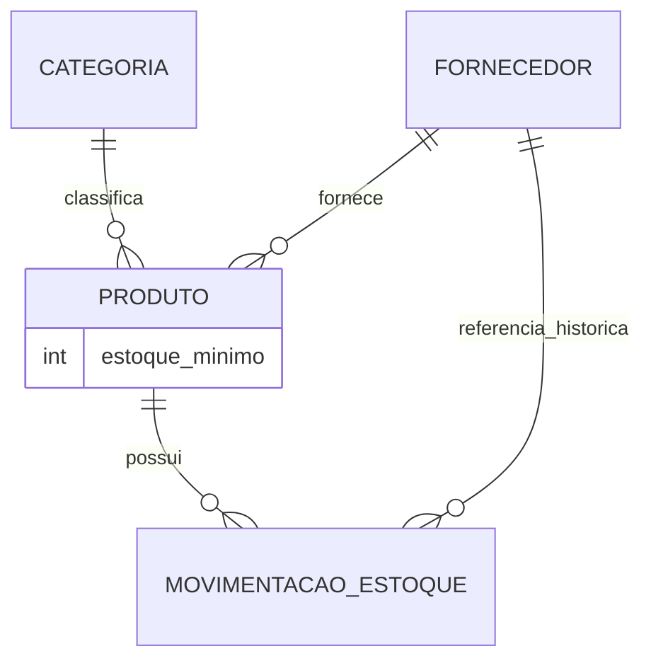

# StockFlow API — Domain and Data Modeling

## 1. Objetivo do documento

Este documento é o caderno vivo de modelagem de domínio e de dados do StockFlow API.

Ele acompanha toda a evolução da modelagem desde a análise inicial dos requisitos até o modelo físico implementado no PostgreSQL, passando pelo MER, DER e mapeamento E-R → relacional.

### Relação com outros documentos

**DECISIONS.md** é a fonte oficial do histórico de decisões técnicas e arquiteturais do projeto. Cada decisão importante deve estar registrada lá, com contexto, alternativas consideradas, escolha adotada, justificativa e consequências.

**DOMAIN_MODELING.md** (este documento) consolida o estado atual da modelagem e serve como material de estudo e consulta durante o desenvolvimento e a defesa técnica. Ele reflete as decisões já aprovadas em DECISIONS.md, mas não as antecipa.

**Regra fundamental:** decisões ainda abertas não devem aparecer neste documento como definitivamente aprovadas. Enquanto uma questão da Matriz DOM permanecer com status OPEN, a modelagem correspondente deve permanecer em aberto neste documento.

---

## 2. Convenções utilizadas

### MER — Modelo Entidade-Relacionamento

O MER é um modelo **conceitual**. Ele descreve o domínio do problema em termos de:

- **Entidades:** objetos ou conceitos relevantes do domínio (ex.: Produto, Fornecedor).
- **Atributos:** propriedades de cada entidade (ex.: nome, sku).
- **Relacionamentos:** associações entre entidades (ex.: Produto pertence a uma Categoria).
- **Cardinalidades:** quantidades envolvidas em cada relacionamento (1:1, 1:N, N:N).
- **Regras relevantes:** restrições e comportamentos do domínio.

O MER não fala de tabelas, colunas nem tipos de dados. É independente de tecnologia.

### DER — Diagrama Entidade-Relacionamento

O DER é a **representação visual** do MER. Neste projeto, o DER será expresso em sintaxe Mermaid (suportada pelo GitHub) para facilitar o versionamento e a revisão no repositório.

### Modelo Relacional

O modelo relacional é a **transformação** do MER em estruturas concretas de banco de dados relacional:

- relações (tabelas);
- chaves primárias (PK);
- chaves estrangeiras (FK);
- constraints de unicidade (UNIQUE);
- constraints de obrigatoriedade (NOT NULL);
- tabelas de associação quando necessárias (para relacionamentos N:N).

O modelo relacional ainda é independente do SGBD. Define a estrutura lógica, não os tipos físicos.

### Modelo Físico

O modelo físico é a **implementação concreta** no PostgreSQL. Inclui:

- tipos de dados específicos (INTEGER, VARCHAR, NUMERIC, TIMESTAMP, ENUM);
- constraints físicas (CHECK, DEFAULT);
- índices;
- regras de exclusão (ON DELETE);
- nomes físicos de tabelas e colunas.

No projeto, o modelo físico será materializado como models SQLAlchemy e migrations Alembic.

### Sequência adotada no projeto

```
Requisitos do desafio
       ↓
Análise de domínio (TSK-2.1 / TSK-2.1B)
       ↓
Resolução de decisões DOM (TSK-2.2 / TSK-2.3)
       ↓
MER aprovado
       ↓
DER em Mermaid
       ↓
Mapeamento E-R → Modelo Relacional
       ↓
Modelo Físico PostgreSQL
       ↓
Models SQLAlchemy (TSK-2.7)
       ↓
Migrations Alembic (TSK-2.8)
```

Esta sequência garante que decisões de modelagem sejam explícitas e compreendidas antes de qualquer implementação.

---

## 3. Fonte dos requisitos

Os requisitos abaixo foram determinados diretamente pelo enunciado do desafio técnico. Nada foi acrescentado ou interpretado nesta seção.

### Produto

Campos mínimos obrigatórios:

- `id`
- `nome`
- `sku` / código único
- `preco_custo`
- `preco_venda`
- `quantidade_em_estoque`
- `data_cadastro`

### Fornecedor

Campos mínimos obrigatórios:

- `id`
- `nome`
- `cnpj` único
- `telefone`
- `email` único

### Categoria

Campos mínimos obrigatórios:

- `id`
- `nome` único

### Movimentação de Estoque

Campos mínimos obrigatórios:

- `id`
- `tipo` (entrada ou saída)
- `quantidade`
- `data`

### Regras de negócio explicitamente declaradas

- Movimentações são registros de auditoria.
- Movimentações são imutáveis: após criadas, não podem ser editadas nem excluídas pela API.
- Somente criação e consulta são permitidas para movimentações.
- Registrar uma movimentação deve refletir automaticamente na quantidade disponível em estoque.
- A modelagem deve garantir integridade referencial.
- O comportamento ao excluir uma categoria que ainda possui produtos deve ser definido.
- Deve existir consulta para produtos no estoque mínimo ou abaixo dele.
- Deve existir filtragem de movimentações por período.
- Deve existir filtragem de movimentações por fornecedor.

---

## 4. Entidades analisadas

### 4.1 Produto

**Responsabilidade no domínio:**
Produto é a entidade central do sistema. Representa um item físico gerenciado pelo estoque. Possui valor monetário, quantidade rastreada em tempo real e identificação única por SKU.

**Atributos explicitamente exigidos:**

| Atributo | Constraint explícita |
|---|---|
| `id` | Identificador único |
| `nome` | — |
| `sku` | UNIQUE |
| `preco_custo` | — |
| `preco_venda` | — |
| `quantidade_em_estoque` | Saldo inicial zero; alterado exclusivamente via Movimentação (DEC-012, DEC-013) |
| `data_cadastro` | — |

**Atributos adicionais aprovados:**

| Atributo | Constraint / Regra |
|---|---|
| `estoque_minimo` | Obrigatório, numérico inteiro, aceita zero, não aceita negativo (DEC-011) |

**Relacionamentos:**

- Categoria 1:N — cada Produto pertence a uma Categoria
- Fornecedor 1:N — cada Produto possui um Fornecedor cadastral
- Produto 1:N Movimentação (confirmado como inferência estrutural, ver seção 5.2)

**Possíveis necessidades adicionais:**

- Um valor de referência de estoque mínimo por produto, necessário para a consulta exigida pelo desafio (ver DOM-004).
- Chave(s) estrangeira(s) para Categoria e Fornecedor: estrutura exata depende de DOM-001 e DOM-002.

**Decisões abertas:**

- DOM-007: política de exclusão de produto com movimentações

---

### 4.2 Fornecedor

**Responsabilidade no domínio:**
Fornecedor representa a entidade externa que provê produtos para a loja. Deve ser identificável de forma única por CNPJ e email. Está relacionado a produtos e, indiretamente, ao histórico de movimentações.

**Atributos explicitamente exigidos:**

| Atributo | Constraint explícita |
|---|---|
| `id` | Identificador único |
| `nome` | — |
| `cnpj` | UNIQUE |
| `telefone` | — |
| `email` | UNIQUE |

**Relacionamentos:**

- Fornecedor 1:N Produto
- Fornecedor 1:N Movimentação como referência histórica

**Possíveis necessidades adicionais:**

- Nenhum campo adicional é necessário para satisfazer os requisitos obrigatórios do desafio. Endereço, site e demais dados cadastrais são fora do escopo.

**Decisões abertas:**

- DOM-008: política de exclusão de fornecedor relacionado a histórico

---

### 4.3 Categoria

**Responsabilidade no domínio:**
Categoria é uma classificação aplicada a produtos. É intencionalmente simples. Sua principal regra de negócio derivada é o comportamento ao ser excluída quando ainda possui produtos associados.

**Atributos explicitamente exigidos:**

| Atributo | Constraint explícita |
|---|---|
| `id` | Identificador único |
| `nome` | UNIQUE |

**Relacionamentos:**

- Categoria 1:N Produto

**Possíveis necessidades adicionais:**

- Nenhum campo adicional é identificado como necessário pelos requisitos do desafio.

**Decisões abertas:**

- DOM-013: política de exclusão de categoria com produtos

---

### 4.4 Movimentação de Estoque

**Responsabilidade no domínio:**
Movimentação é o registro imutável de auditoria de cada alteração no estoque de um produto. Representa um evento que já ocorreu. Não pode ser corrigida; erros são compensados por novas movimentações.

**Atributos explicitamente exigidos:**

| Atributo | Constraint explícita |
|---|---|
| `id` | Identificador único |
| `tipo` | Entrada ou saída |
| `quantidade` | — |
| `data` | — |

**Relacionamentos:**

- Produto 1:N Movimentação
- Fornecedor 1:N Movimentação
- Fornecedor histórico capturado do Produto na criação

**Possíveis necessidades adicionais:**

- `produto_id`: inferência estrutural necessária — sem saber qual produto a movimentação afeta, ela não tem utilidade para auditoria nem para atualização de estoque.
- Referência a Fornecedor: necessária para filtro por fornecedor; forma exata em aberto (DOM-003).

**Decisões abertas:**

- DOM-009: representação do tipo (enum, string com CHECK, outro)
- DOM-010: origem da data (gerada pelo servidor ou informada pelo cliente)
- DOM-011: quantidade aceita zero? aceita negativo?
- DOM-012: saída pode ultrapassar estoque disponível?

---

## 5. Requisitos, inferências e decisões

### 5.1 Requisitos explícitos

Fatos determinados diretamente pelo enunciado do desafio. Não exigem interpretação ou escolha.

| # | Requisito |
|---|---|
| RE-01 | Produto possui: id, nome, sku único, preco_custo, preco_venda, quantidade_em_estoque, data_cadastro |
| RE-02 | Fornecedor possui: id, nome, cnpj único, telefone, email único |
| RE-03 | Categoria possui: id, nome único |
| RE-04 | Movimentação possui: id, tipo (entrada/saída), quantidade, data |
| RE-05 | Movimentações são imutáveis após criação |
| RE-06 | API não oferece edição nem exclusão de movimentações |
| RE-07 | Criar movimentação deve atualizar automaticamente o estoque do produto |
| RE-08 | Integridade referencial deve ser garantida pelo modelo |
| RE-09 | Exclusão de categoria com produtos deve ter comportamento definido |
| RE-10 | Deve existir consulta de produtos no estoque mínimo ou abaixo dele |
| RE-11 | Movimentações devem ser filtráveis por período |
| RE-12 | Movimentações devem ser filtráveis por fornecedor |

---

### 5.2 Inferências estruturais necessárias

Estas conclusões não foram declaradas explicitamente no enunciado, mas são **necessárias** para que os requisitos explícitos possam ser implementados. Sem elas, um ou mais requisitos tornam-se tecnicamente irrealizáveis.

| # | Inferência | Requisito que a exige | Justificativa |
|---|---|---|---|
| IE-01 | Movimentação deve identificar o Produto afetado (`produto_id`) | RE-07 — movimentação atualiza o estoque | Sem saber qual produto alterar, a atualização de estoque é impossível |
| IE-02 | Produto precisa de um valor de referência de estoque mínimo | RE-10 — consulta de produtos no/abaixo do mínimo | Comparação `quantidade <= mínimo` é impossível sem o valor mínimo por produto |
| IE-03 | Criação de movimentação e atualização de estoque devem ser atômicas | RE-07; AGENTS.md — sem estado parcial | Falha entre os dois passos deixaria o banco em estado inconsistente |
| IE-04 | A API não deve alterar movimentações nem excluí-las | RE-05, RE-06 | Imutabilidade é requisito explícito; ausência de endpoints PUT/PATCH/DELETE para movimentações é necessária |

**Sobre IE-02 (estoque mínimo):**

A necessidade de um valor de referência foi confirmada estruturalmente. A solução aprovada é a criação do campo `estoque_minimo` diretamente na entidade Produto (ver DEC-011 e RA-04).

---

### 5.3 Regras propostas / decisões ainda abertas

*Todas as regras propostas (RPs) emergentes da análise do domínio foram formalmente resolvidas e promovidas a regras aprovadas (RAs).*

---

### 5.4 Decisões de modelagem aprovadas

As regras abaixo foram formalmente decididas e aprovadas:

| # | Regra aprovada | DEC correspondente |
|---|---|---|
| RA-01 | Um produto pertence a uma única categoria (cardinalidade 1:N) | DEC-008 |
| RA-02 | Um produto possui um único fornecedor cadastral (cardinalidade 1:N) | DEC-009 |
| RA-03 | Movimentação armazena referência direta e histórica ao fornecedor associado ao Produto no momento da criação | DEC-010 |
| RA-04 | Produto possui o atributo `estoque_minimo` (obrigatório, numérico inteiro, sem default, >= 0) | DEC-011 |
| RA-05 | `quantidade_em_estoque` é um saldo persistido, atualizado exclusivamente por Movimentação, não alterável livremente no CRUD | DEC-012 |
| RA-06 | Produto nasce com estoque zero; adição de estoque inicial exige Movimentação de entrada separada | DEC-013 |
| RA-07 | Quantidade da Movimentação deve ser estritamente maior que zero (representa apenas magnitude) | DEC-014 |
| RA-08 | Saída acima do saldo disponível no Produto é inválida; estoque negativo não é permitido | DEC-015 |
| RA-09 | O `tipo` de Movimentação é um conjunto fechado de 2 valores (ENTRADA e SAÍDA) | DEC-016 |
| RA-10 | A `data` da Movimentação é gerada pelo servidor no momento da criação | DEC-017 |
| RA-11 | Categoria não pode ser excluída se possuir produtos associados (RESTRICT) | DEC-018 |
| RA-12 | Produto não pode ser excluído se possuir movimentações (RESTRICT) | DEC-019 |
| RA-13 | Fornecedor não pode ser excluído se possuir produtos ou movimentações (RESTRICT) | DEC-020 |

---

## 6. Matriz de ambiguidades DOM

As questões abaixo permanecem abertas até aprovação explícita. Nenhuma deve ser resolvida silenciosamente durante a implementação.

| ID | Questão | Requisito relacionado | Alternativas | Impacto | Dependências | Status |
|---|---|---|---|---|---|---|
| DOM-001 | Cardinalidade Categoria–Produto: um produto pertence a uma ou múltiplas categorias? | RE-09 (exclusão de categoria com produtos) | 1:N — FK em Produto; N:N — tabela associativa | Estrutura do banco; política de exclusão; complexidade do CRUD | — | **CLOSED / ACCEPTED (DEC-008)** |
| DOM-002 | Cardinalidade Fornecedor–Produto: um produto tem um ou múltiplos fornecedores? | RE-12 (filtro por fornecedor) | 1:N — FK em Produto; N:N — tabela associativa | Estrutura do banco; rastreabilidade histórica; complexidade do filtro | — | **CLOSED / ACCEPTED (DEC-009)** |
| DOM-003 | Como a Movimentação referencia o Fornecedor para permitir filtro? | RE-12 (filtro de movimentações por fornecedor) | (a) Join via Produto; (b) `supplier_id` opcional direto na movimentação | Rastreabilidade histórica se fornecedor do produto mudar; complexidade de JOIN | DOM-002 | **CLOSED / ACCEPTED (DEC-010)** |
| DOM-004 | Como representar estoque mínimo por produto? Nome, tipo, valor padrão, validações | RE-10 (consulta estoque mínimo) | Campo `estoque_minimo` em Produto; global fixo; parâmetro na query | Impossibilidade da consulta sem valor de referência | — | **CLOSED / ACCEPTED (DEC-011)** |
| DOM-005 | `quantidade_em_estoque` pode ser alterada diretamente no CRUD de Produto após criação? | RE-07 (movimentação atualiza estoque); auditoria | (A) Livre no CRUD; (B) Somente via movimentações; (C) Ajuste de inventário como tipo especial | Integridade e rastreabilidade do histórico | — | **CLOSED / ACCEPTED (DEC-012)** |
| DOM-006 | Como representar o estoque inicial de um produto recém-cadastrado? | RE-01 (campo `quantidade_em_estoque`) | (1) Campo direto na criação sem movimentação; (2) Sempre zero + movimentação manual; (3) Campo gera movimentação automática | Auditoria; UX da API; consistência | DOM-005 | **CLOSED / ACCEPTED (DEC-013)** |
| DOM-007 | O que acontece ao excluir um Produto que possui movimentações? | RE-05/RE-06 (imutabilidade); auditoria | RESTRICT; CASCADE (destrói histórico); SET NULL; soft delete | Preservação do histórico de auditoria | — | **CLOSED / ACCEPTED (DEC-019)** |
| DOM-008 | O que acontece ao excluir um Fornecedor relacionado a produtos ou movimentações? | RE-12 (filtro por fornecedor); integridade | RESTRICT; SET NULL; soft delete | Rastreabilidade histórica; integridade do filtro por fornecedor | DOM-003 | **CLOSED / ACCEPTED (DEC-020)** |
| DOM-009 | Como representar o tipo entrada/saída na Movimentação? | RE-04 (campo `tipo`) | Enum de banco; VARCHAR com CHECK; booleano | Clareza semântica; portabilidade entre SGBDs | — | **CLOSED / ACCEPTED (DEC-016)** |
| DOM-010 | A `data` da movimentação é gerada pelo servidor ou informada pelo cliente? | RE-04 (campo `data`) | Servidor (timestamp do momento da criação); cliente (informado no corpo da requisição) | Confiabilidade da auditoria; possibilidade de registros retroativos | — | **CLOSED / ACCEPTED (DEC-017)** |
| DOM-011 | Quantidade de movimentação aceita zero? Aceita negativo? | RE-07 (movimentação altera estoque) | Somente > 0; aceitar zero; aceitar negativo | Integridade dos registros de auditoria; significado semântico | — | **CLOSED / ACCEPTED (DEC-014)** |
| DOM-012 | Saída de estoque pode ultrapassar a quantidade disponível? | RE-07; integridade do estoque | Bloquear com erro; permitir (estoque negativo); permitir com alerta | Possibilidade de estoque negativo | DOM-011 | **CLOSED / ACCEPTED (DEC-015)** |
| DOM-013 | O que acontece ao excluir uma Categoria que possui produtos associados? | RE-09 (comportamento explicitamente mencionado) | RESTRICT; SET NULL (produto sem categoria); CASCADE (deleta produtos); soft delete da categoria | Integridade dos produtos; produtos órfãos de categoria | DOM-001 | **CLOSED / ACCEPTED (DEC-018)** |

---

## 7. Ordem de resolução das decisões DOM

A ordem abaixo respeita as dependências entre as decisões. Decisões anteriores condicionam as posteriores.

| Prioridade | ID | Justificativa da posição |
|---|---|---|
| **Resolvido** | **DOM-001** | **Define se haverá FK simples ou tabela associativa entre Produto e Categoria** |
| **Resolvido** | **DOM-002** | **Define se haverá FK simples ou tabela associativa entre Produto e Fornecedor** |
| **Resolvido** | **DOM-003** | **Depende de DOM-002; define o modelo de rastreabilidade do fornecedor na movimentação** |
| **Resolvido** | **DOM-004** | **Define campo adicional em Produto; necessário para a consulta de estoque mínimo** |
| **Resolvido** | **DOM-005** | **Define regra central de negócio para o CRUD de Produto** |
| **Resolvido** | **DOM-006** | **Depende de DOM-005; define o comportamento da criação do produto com estoque** |
| **Resolvido** | **DOM-009** | **Define o campo `tipo` no modelo de movimentação** |
| **Resolvido** | **DOM-010** | **Define o campo `data` no modelo de movimentação** |
| **Resolvido** | **DOM-011** | **Define validação de quantidade na movimentação** |
| **Resolvido** | **DOM-012** | **Define regra de negócio para saídas; depende de DOM-011** |
| **Resolvido** | **DOM-013** | **Define comportamento de exclusão de Categoria; depende de DOM-001** |
| **Resolvido** | **DOM-007** | **Define comportamento de exclusão de Produto; depende do CRUD estar estruturado** |
| **Resolvido** | **DOM-008** | **Define comportamento de exclusão de Fornecedor; depende de DOM-003** |

> A ordem pode ser ajustada se novas dependências forem identificadas durante a implementação. Qualquer ajuste deve ser justificado.

---

## 8. MER — Modelo Conceitual

**Status: decisões de domínio concluídas — aguardando revisão final/consolidação.**

### Entidades obrigatórias identificadas

As quatro entidades abaixo são confirmadas como presentes no domínio:

- **Produto**
- **Fornecedor**
- **Categoria**
- **Movimentação de Estoque**

### Relacionamentos identificados

| Relacionamento | Cardinalidade | Status |
|---|---|---|
| Categoria ↔ Produto | 1:N | DEC-008 (Resolvido) |
| Fornecedor ↔ Produto | 1:N | DEC-009 (Resolvido) |
| Produto ↔ Movimentação | 1:N (Produto tem muitas Movimentações) | Inferência confirmada (IE-01) |
| Fornecedor ↔ Movimentação | 1:N | DEC-010 (Fornecedor histórico associado ao Produto no momento da movimentação) |

O MER completo será produzido após a resolução das demais questões DOM abertas.

---

## 9. DER — Diagrama Entidade-Relacionamento

**Status: PARCIAL — aguardando decisões DOM restantes**

O DER será representado em sintaxe Mermaid (`erDiagram`) e versionado nesta seção.



**Nota sobre a notação:**
- `||` no lado de Categoria/Fornecedor/Produto representa uma entidade obrigatória para a instância relacionada (ou seja, todo Produto tem uma Categoria obrigatória).
- `o{` indica zero ou muitas ocorrências do lado plural.
- O diagrama ainda é parcial; atributos e constraints restantes serão completados após DOM-004 em diante.

---

## 10. Mapeamento E-R → Modelo Relacional

**Status: PARCIALMENTE APROVADO — aguardando demais decisões DOM**

Esta seção descreverá, para cada entidade e relacionamento aprovado no MER, a tabela relacional resultante.

**Consequências já garantidas pelas decisões:**

- O relacionamento Categoria 1:N Produto será mapeado futuramente por FK no lado Produto;
- O relacionamento Fornecedor 1:N Produto será mapeado futuramente por FK no lado Produto;
- O relacionamento Produto 1:N Movimentação implica FK de Produto em Movimentação;
- O relacionamento Fornecedor 1:N Movimentação implica FK de Fornecedor em Movimentação.

Ainda **não** estão definidos:

- Nomes físicos finais;
- Tipos SQL;
- Regras de exclusão (ON DELETE);
- Nullability física além da semântica conceitual já decidida;
- Índices;
- Constraints restantes.

Esta seção será preenchida completamente após DOM-004 e as demais estarem resolvidas.

---

## 11. Modelo Físico PostgreSQL

**Status: AGUARDANDO MODELO RELACIONAL**

Somente após o modelo relacional ser aprovado, serão definidos os detalhes físicos de cada tabela no PostgreSQL:

- tipos de dados: `INTEGER`, `BIGINT`, `VARCHAR`, `TEXT`, `NUMERIC`, `TIMESTAMP`, `BOOLEAN`
- representação do tipo de movimentação: enum de banco ou `VARCHAR` com `CHECK` (DOM-009)
- precisão de valores monetários: `NUMERIC(p, s)` — precisão e escala a definir (referência: Parte 8 da análise TSK-2.1)
- campos de data/hora com ou sem timezone
- constraints `DEFAULT`
- regras `ON DELETE` para cada FK
- índices recomendados

Esta seção será preenchida durante as TSK-2.4 a TSK-2.8.

---

## 12. Não requisitos — Controle de escopo

As funcionalidades abaixo estão **fora do escopo atual** do StockFlow API. Nenhuma delas deve ser introduzida sem instrução explícita do desenvolvedor.

### Fora do escopo

| Funcionalidade | Motivo |
|---|---|
| Múltiplos depósitos / localizações de estoque | Não mencionado no desafio |
| Controle por lote | Não mencionado no desafio |
| Data de validade | Não mencionada no desafio |
| Código de barras (EAN) | Não mencionado; SKU cobre identificação |
| Endereço do fornecedor | Não mencionado; campos exigidos são nome, CNPJ, telefone e email |
| Usuário responsável pela movimentação | Autenticação é diferencial, tratado separadamente |
| Pedidos de compra | Não mencionado; movimentação de entrada cobre a entrada de mercadoria |
| Vendas / pedidos de venda | Não mencionado; movimentação de saída cobre a saída |
| Clientes | Não mencionados no desafio |
| Notas fiscais | Não mencionadas no desafio |
| Reserva de estoque | Não mencionada; exigiria estado intermediário entre disponível e reservado |
| Fotos e imagens de produto | Não mencionadas no desafio |
| Preço por fornecedor | Não mencionado; tornaria a relação Produto–Fornecedor mais complexa sem requisito |

### Possíveis extensões futuras (não requisitos atuais)

| Funcionalidade | Observação |
|---|---|
| Observação / motivo na movimentação | Útil em prática (ex.: "entrada por reposição", "saída por avaria"), mas não exigido |
| Unidade de medida do produto | Relevante para produtos não unitários (kg, litros), mas não mencionado no desafio |

Estas extensões não devem ser tratadas como requisitos enquanto o enunciado não as exigir.

---

## 13. Notas para defesa técnica

Esta seção reúne perguntas de estudo sobre modelagem de dados. As respostas específicas do StockFlow serão acrescentadas conforme as decisões forem aprovadas.

### Conceitos gerais

**O que é MER?**
O Modelo Entidade-Relacionamento é uma representação conceitual do domínio. Descreve as entidades, seus atributos, os relacionamentos entre elas e as cardinalidades, de forma independente de tecnologia.

**O que é DER?**
O Diagrama Entidade-Relacionamento é a representação visual do MER. Mostra graficamente as entidades, atributos e relacionamentos.

**Qual a diferença entre MER e modelo relacional?**
O MER é conceitual e tecnologia-independente. O modelo relacional traduz o MER para estruturas concretas de banco de dados: tabelas, colunas, PKs, FKs e constraints. Um relacionamento N:N no MER, por exemplo, se transforma em uma tabela de associação no modelo relacional.

**O que é cardinalidade?**
Cardinalidade define quantas instâncias de uma entidade se relacionam com instâncias de outra. As principais são:
- **1:1** — uma entidade se relaciona com exatamente uma da outra.
- **1:N** — uma entidade se relaciona com muitas da outra.
- **N:N** — muitas instâncias de cada lado se relacionam entre si.

**Como um relacionamento 1:N é mapeado para tabelas?**
A chave primária do lado "1" é adicionada como chave estrangeira (FK) no lado "N". Exemplo: Categoria (1) ↔ Produto (N) → coluna `category_id` em Produto referenciando Categoria.

**Como um relacionamento N:N é mapeado para tabelas?**
Cria-se uma tabela de associação com duas chaves estrangeiras, uma para cada entidade do relacionamento. A chave primária da tabela de associação é normalmente a combinação das duas FKs.

**O que é chave primária (PK)?**
Um atributo ou conjunto de atributos que identifica unicamente cada linha de uma tabela. Não permite valores nulos nem duplicados.

**O que é chave estrangeira (FK)?**
Um atributo em uma tabela que referencia a chave primária de outra tabela. Garante que a referência aponte para um registro existente (integridade referencial).

**O que é integridade referencial?**
A garantia de que uma FK sempre aponta para um registro existente na tabela referenciada. O banco impede a criação de registros com FKs inválidas e impede a exclusão de registros referenciados por outros (a menos que CASCADE ou SET NULL estejam configurados).

### Específicas do StockFlow

**Por que não começamos diretamente pelos models SQLAlchemy?**
Porque models SQLAlchemy são a representação física da modelagem. Criá-los antes de definir o MER e o modelo relacional significa tomar decisões de banco de dados implicitamente, sem análise. Erros de modelagem descobertos depois exigem migrations corretivas e podem gerar retrabalho significativo.

**Qual a diferença entre requisito explícito e decisão de modelagem?**
Requisito explícito é o que o enunciado determina diretamente. Decisão de modelagem é como o desenvolvedor escolhe implementar aquele requisito (ou como representa algo que o requisito implica mas não especifica). Confundir os dois leva a tratar escolhas como obrigações ou a implementar algo sem fundamento no requisito.

**Por que movimentações exigem atenção especial à auditoria?**
Porque são imutáveis por design. Uma vez criadas, não podem ser corrigidas pela API. Isso garante que o histórico seja confiável e não possa ser adulterado retroativamente. Toda alteração de estoque deve ser rastreável por uma movimentação correspondente. Se a operação de criação de movimentação e atualização de estoque não for atômica, o banco pode ficar em estado inconsistente.

**Por que Categoria–Produto foi modelado como 1:N?**
Porque o desafio não exige múltiplas categorias por produto, a relação 1:N atende ao escopo, evita tabela associativa sem necessidade, e simplifica a integridade e o CRUD. (DEC-008)

**Por que Produto–Fornecedor foi modelado como 1:N?**
Porque satisfaz o requisito atual de forma mais simples e a presença de múltiplos fornecedores na loja não implica que um mesmo produto seja fornecido por vários simultaneamente. (DEC-009)

**Por que não usamos N:N para Produto–Fornecedor?**
Porque adicionaria complexidade não solicitada (gestão de associações e ambiguidade no filtro histórico), e a tabela associativa não traz benefício dentro do escopo do desafio.

**Por que Movimentação possui referência direta ao Fornecedor se Produto já possui?**
Para garantir a integridade do histórico. Se o fornecedor atual do produto for alterado no futuro, um JOIN indireto (`Movimentação -> Produto -> Fornecedor`) associaria movimentações antigas ao novo fornecedor. (DEC-010)

**Isso não é duplicação de dados?**
Não de forma indevida, pois as semânticas temporais são diferentes: o Produto armazena o fornecedor cadastral *atual*, enquanto a Movimentação armazena o fornecedor associado ao Produto *no momento daquele evento*.

**O que acontece historicamente se o fornecedor de um Produto mudar?**
O `supplier_id` do Produto é atualizado para o novo fornecedor. Movimentações antigas preservam o `supplier_id` anterior (histórico), e as novas receberão o novo `supplier_id`. O filtro por fornecedor continuará exato historicamente.

**O que supplier_id significa numa movimentação de saída?**
Não significa que o fornecedor "causou" ou participou da saída, mas sim que ele era o fornecedor cadastral histórico do produto naquele momento da movimentação.

**Por que a quantidade_em_estoque não é calculada em tempo real (on-the-fly) pelas movimentações?**
Porque o domínio conceitual exige que ela seja uma propriedade do Produto (RE-01) e persista seu valor para eficiência. Calcular em tempo real para toda listagem prejudicaria a performance de consultas. A consistência é mantida atualizando o saldo persistido exclusivamente através de movimentações (DEC-012).

**Por que não permitimos informar um saldo inicial não-zero ao criar o produto?**
Para evitar criação de saldo "fantasma" sem origem auditável e para não gerar forte acoplamento no domínio (criação de Produto disparando criação automática de Movimentação oculta). Com saldo inicial zero, toda adição (inclusive a primeira) segue a exata mesma regra e origem: uma movimentação explícita de entrada pelo cliente (DEC-013).

**Por que não permitimos quantidade negativa nas movimentações de saída?**
A quantidade da movimentação representa a magnitude da operação e deve ser sempre um valor absoluto (`> 0`). O direcionamento (somar ou subtrair do saldo) é determinado exclusivamente pelo campo `tipo`. Isso evita ambiguidades (como subtrair uma quantidade -10, que matematicamente resultaria numa soma) e deixa claro o registro histórico. (DEC-014)

**O sistema permite estoque negativo?**
Não. Uma movimentação de saída só é válida se a quantidade não ultrapassar o saldo disponível. Saldos negativos implicam em promessas de compra/backorder que não fazem parte do escopo atual do desafio, portanto bloquear a operação previne a corrupção do estoque (DEC-015).

**Por que não usar um tipo booleano para a Movimentação (ex: is_entrada)?**
O atributo `tipo` representa um conceito semântico do domínio de negócios (Entrada ou Saída). Um booleano reduz a expressividade do modelo. Nomes explícitos (ENTRADA, SAÍDA) facilitam a leitura e compreensão dos registros de auditoria e evitam confusões, sem prejudicar a performance (DEC-016).

**Por que a data da movimentação não pode ser informada pelo cliente na requisição?**
Movimentações são registros de auditoria do sistema, devendo refletir a realidade do momento em que ocorreram no banco de dados. Permitir que o cliente envie a data abre margem para lançamentos retroativos, fraudes ou inconsistências de fuso horário/relógios locais, além de fugir do escopo essencial do desafio (DEC-017).

**Por que a exclusão (de Produto, Categoria ou Fornecedor) usa uma abordagem RESTRICT em vez de CASCADE ou SET NULL?**
Porque a consistência histórica do estoque e a auditoria de movimentações são prioridades absolutas do domínio. Um `CASCADE` destruiria dados críticos de histórico (ex: apagar uma categoria apagaria produtos, que apagaria o histórico de movimentações). Um `SET NULL` deixaria movimentações ou produtos "órfãos", violando as restrições obrigatórias (ex: todo produto deve ter uma categoria). A regra RESTRICT atua como salvaguarda, garantindo que entidades em uso nunca sejam corrompidas ou apagadas acidentalmente (DEC-018, DEC-019, DEC-020).

---

## 14. Histórico de evolução da modelagem

| Versão | Marco | Situação |
|---|---|---|
| v0.1 | TSK-2.1 — Levantamento inicial de domínio e ambiguidades (13 questões DOM identificadas) | CONCLUÍDO |
| v0.2 | TSK-2.1B — Documentação formal da análise em DOMAIN_MODELING.md | CONCLUÍDO |
| v0.3 | TSK-2.2 — Resolução de DOM-001 a DOM-003 (relacionamentos centrais, MER parcial, primeiro DER parcial) | CONCLUÍDO |
| v0.4 | TSK-2.3 — Resolução de DOM-004 (estoque mínimo) | CONCLUÍDO |
| v0.5 | TSK-2.3 — Resolução de DOM-005 e DOM-006 (quantidade em estoque e saldo inicial) | CONCLUÍDO |
| v0.6 | TSK-2.3 — Resolução de DOM-011 e DOM-012 (quantidade e saída de estoque) | CONCLUÍDO |
| v0.7 | TSK-2.3 — Resolução de DOM-009 e DOM-010 (tipo e data da movimentação) | CONCLUÍDO |
| v0.8 | TSK-2.3 — Resolução de DOM-007, DOM-008 e DOM-013 (regras de exclusão) | CONCLUÍDO |
| v0.9 | MER aprovado com cardinalidades definidas | PENDENTE |
| v0.10 | DER em Mermaid versionado | PENDENTE |
| v0.11 | Modelo relacional mapeado | PENDENTE |
| v0.12 | Modelo físico PostgreSQL definido (TSK-2.4) | PENDENTE |
